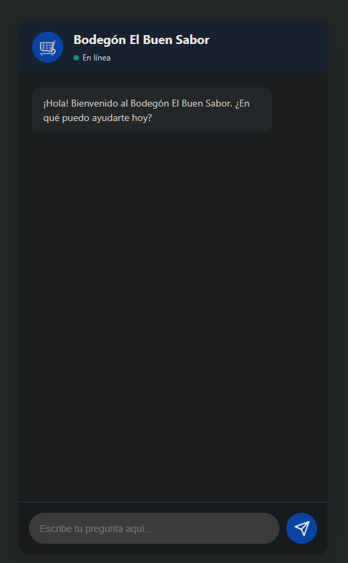
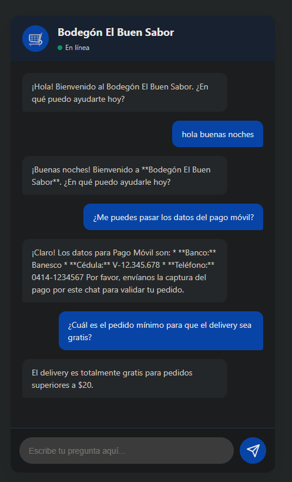
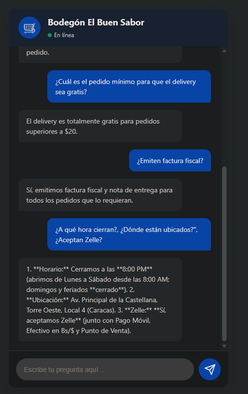
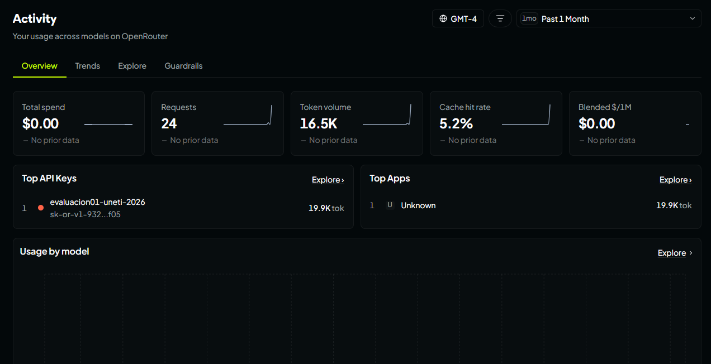

# 🤖 Asistente Virtual FAQ - Bodegón El Buen Sabor


Aplicación web que integra Inteligencia Artificial (NLP) para automatizar la atención al cliente de un comercio local. Desarrollada como parte de la **Evaluación 1** de la unidad curricular de Inteligencia Artificial (UNA).

## 📸 Capturas de pantalla

**1. Interfaz inicial con identidad del negocio:**



**2. Respuestas sobre Pago Móvil y Delivery:**



**3. Respuestas sobre facturación y scroll dinámico:**



**4. Evidencia de costo cero (Panel de OpenRouter):**



## ✨ Características

- **Interfaz conversacional amigable:** diseño UI/UX tipo chat con cabecera personalizada.
- **Respuestas contextualizadas:** configurado con un *System Prompt* estricto que impide inventar información.
- **Consultas soportadas:**
  - Métodos de pago (Pago Móvil, Zelle, efectivo, punto de venta).
  - Datos exactos para Pago Móvil.
  - Reglas de delivery (zonas, costo y envío gratis en pedidos mayores a $20).
  - Horarios, ubicación y facturación.
- **Scroll dinámico:** la ventana del chat mantiene un tamaño fijo con scroll interno.
- **Costo cero:** utiliza el enrutador `openrouter/free` con límite de crédito establecido en $0.00.

## 🛠️ Tecnologías utilizadas

- **HTML5 y CSS3:** estructura y diseño responsivo.
- **JavaScript (Vanilla):** lógica del cliente, manejo del DOM y peticiones `Fetch`.
- **OpenRouter API:** integración de modelos de lenguaje (LLM) gratuitos.
- **Netlify:** despliegue y hosting del sitio.

## 🚀 Ejecución local

1. Clona este repositorio o descarga los archivos.
2. Abre el archivo `script.js` y en la constante `API_KEY` coloca tu propia clave de OpenRouter (puedes obtener una gratis en [OpenRouter.ai](https://openrouter.ai)).
3. Levanta un servidor local desde la carpeta del proyecto:

```bash
python -m http.server 8080
```

4. Abre tu navegador en `http://localhost:8080`.

> **Nota:** abre el sitio a través del servidor local, no haciendo doble clic en `index.html`. Las peticiones a la API requieren un origen `http://localhost`, no el esquema `file://`.

## ⚠️ Seguridad

- La clave API no debe subirse al repositorio. Revisa que `script.js` esté cubierto por `.gitignore` antes de hacer push, o usa un archivo local que no se publique.
- Mantén el límite de crédito en **$0.00** en tu panel de OpenRouter para evitar cargos accidentales.
- Para un despliegue público, lo recomendable es ocultar la clave en el backend con **Netlify Functions** en lugar de dejarla en el JavaScript del cliente.

## 📄 Licencia

Este proyecto está bajo la [Licencia MIT](LICENSE).

## 👤 Autor

**Darwin Colmenares** - 2026